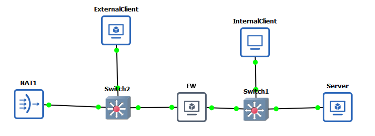
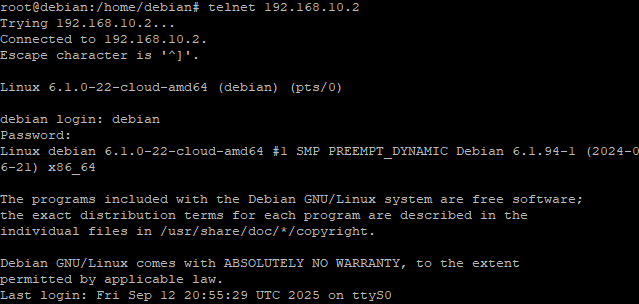
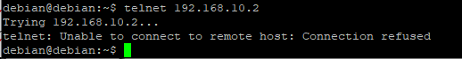
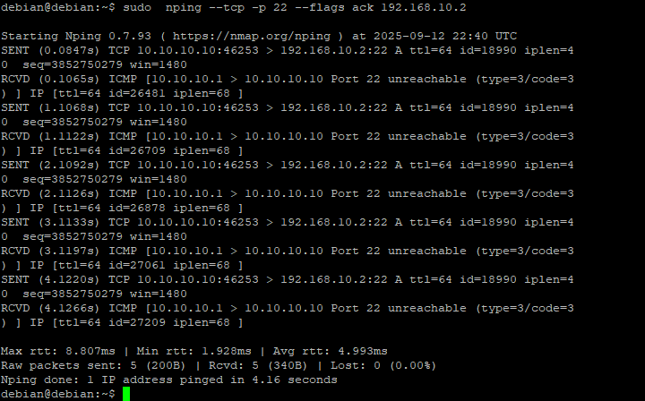
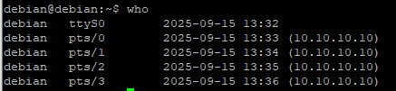
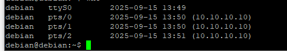
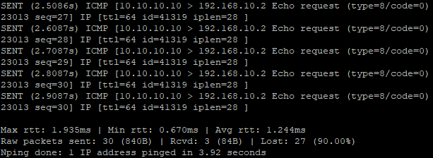

# Межсетевой экран между двумя подсетями Linux

Я настроил шлюз, через который внешний клиент обращался к сервисам внутреннего сервера. Проверил четыре разных свойства фильтрации: отказ по адресу и порту, учёт состояния TCP, число одновременных SSH-соединений и частоту ICMP-запросов. Для каждой проверки сравнил поведение клиента с тем, что происходило на шлюзе или сервере.

На схеме проверяемый путь проходит от ExternalClient (`10.10.10.10`) через FW к Server (`192.168.10.2`). Внешний интерфейс шлюза имел адрес `10.10.10.1`, внутренний — `192.168.10.1`. Поместил правила в цепочку `FORWARD` таблицы `filter`, поскольку пакеты адресованы конечному серверу. Полный набор правил в порядке обработки сохранил в [forward.rules](forward.rules).

## Telnet: сервис доступен, пока шлюз разрешает соединение

Сначала проверил, что сервер слушает TCP/23, затем подключился к нему с клиента. На первом снимке видны установленное соединение и вход в Debian. После этого включил правило с действием `REJECT` для адреса клиента и порта 23. При повторной попытке тот же клиент сразу получил `Connection refused`.

## TCP: как шлюз обработал одиночный ACK

С внешнего клиента отправил через nping TCP-пакет на порт 22 с выставленным флагом ACK без предварительного установления соединения. В правиле проверял и флаг ACK, и состояние по conntrack. Шлюз увидел, что пакет не принадлежит соединению в состоянии `ESTABLISHED`, и вернул ICMP Destination Unreachable. На снимке строки SENT и RCVD показывают исходный ACK и ответ шлюза.

## SSH: ограничение числа соединений с одного адреса

До включения ограничения я открыл четыре удалённых сеанса. Затем установил порог через `connlimit` с маской `/32`, чтобы учитывать соединения каждого IPv4-адреса отдельно. Четвёртая попытка осталась в ожидании: правило `DROP` отбросило пакет без ответа. Сверил результат на сервере через `who`: после включения ограничения видны три удалённых сеанса с адреса клиента. Строка `tty1` относится к локальной консоли.

## ICMP: что прошло при нагрузке выше лимита

Первым правилом разрешил один Echo Request в секунду с начальным запасом в один пакет. Следующим правилом отбросил остальные Echo Request. Такой порядок важен: когда лимит исчерпан, пакет продолжает проход по цепочке и попадает под DROP.

Проверил результат серией из 30 запросов при скорости 10 в секунду. В итоговой строке nping видны 30 отправленных пакетов, 3 полученных ответа и 27 потерь. Ограничение действовало на весь поток, совпадающий с правилом.

